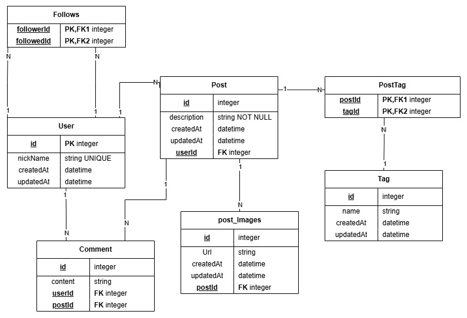

# Diagrama Entidad-Relación (DER)

El siguiente DER representa las entidades y asociaciones implementadas en los modelos de Sequelize de **UnaHur Anti-Social Net**. Mantiene la estructura del diagrama realizado en draw.io y utiliza los nombres de atributos y tablas que corresponden al código actual.

## Entidades y relaciones

- **User–Post (1:N):** un usuario puede crear muchas publicaciones. Cada publicación pertenece a un usuario mediante `Post.userId`.
- **User–Comment (1:N):** un usuario puede escribir muchos comentarios. Cada comentario identifica a su autor mediante `Comment.userId`.
- **Post–Comment (1:N):** una publicación puede recibir muchos comentarios. Cada comentario pertenece a una publicación mediante `Comment.postId`.
- **Post–Post_Images (1:N):** una publicación puede tener varias imágenes. Cada imagen guarda su URL en `Url` y referencia la publicación con `postId`; esto permite agregar o quitar imágenes después de crear el post.
- **Post–Tag (N:M):** una publicación puede tener varias etiquetas y una etiqueta puede asociarse a muchas publicaciones. Sequelize administra esta relación mediante la tabla intermedia `PostTag`, con `postId` y `tagId` como claves foráneas y parte de su clave primaria compuesta.

## Claves, atributos y restricciones

- Los modelos usan `id` como clave primaria. Sequelize agrega `createdAt` y `updatedAt` automáticamente porque no se deshabilitaron las marcas de tiempo.
- `User.nickName` es obligatorio y único. En la base de datos, el modelo configura el nombre físico de esa columna como `nickname` mediante `field: "nickname"`.
- `Post.description` es obligatorio, y `Post.userId` también debe estar presente.
- Los comentarios requieren `userId` y `postId`, para asociar cada comentario con un autor y una publicación.
- La imagen se almacena como una URL de texto en `Post_Images.Url`; no se guarda el archivo de imagen en la base de datos.
- La tabla intermedia se llama `PostTag` en las asociaciones de Sequelize. En el diagrama de draw.io puede aparecer como `Post_Tag`; para coincidir con el código actual se usa `PostTag` en este DER.

## Validaciones de la API relacionadas con el modelo

Además de las relaciones del DER, las rutas aplican middleware de Express y schemas Joi para validar datos de entrada e identificadores:

- `validarSchema` valida el cuerpo de las peticiones con el schema correspondiente.
- `validarId` comprueba el formato del identificador de rutas que lo utilizan.
- `validarRelacionesComentario` verifica que existan el usuario y la publicación antes de crear un comentario.
- `validarRelacionImagen` verifica que exista la publicación asociada antes de crear o modificar una imagen.
- Los middlewares de las rutas de usuarios, publicaciones y etiquetas también verifican los recursos relacionados cuando corresponde.
- La API responde con códigos HTTP adecuados para errores de validación y recursos inexistentes; el `nickName` duplicado se informa como conflicto (`409`).
